<!-- ═══════════════════════════ HERO ═══════════════════════════ -->

 

<!-- ═══════════════════════════ ABOUT ═══════════════════════════ -->
<h2 align="center">👨‍💻 About Me</h2>

I'm a frontend-focused **Flutter mobile developer from India** who enjoys building clean, responsive cross-platform apps with Flutter and Dart. I'm now broadening my skill set into **full-stack development**: React, Python, backend services and API integration, so I can take products from interface to server end to end.

| | |
|:--|:--|
| 🔭 **Building** | [VedicMitra](https://github.com/arao62916-sys/VedicMitra), a pooja app |
| 🌱 **Learning** | React · Python · Backend Development · API Integration · Full-Stack Development |
| 💬 **Ask me about** | Flutter, Dart, Firebase, REST APIs, React, Python and Mobile App Development |
| 🐙 **GitHub** | [@akashvaidya-dev](https://github.com/akashvaidya-dev) |
| 🌐 **Portfolio** | [akashvadya.cv](https://akashvadya.cv): all my projects in one place |
| 📫 **Reach me** | [raoakash606@gmail.com](mailto:raoakash606@gmail.com) |

<!-- ═══════════════════════════ TECH STACK ═══════════════════════════ -->
<h2 align="center">🛠️ Tech Stack</h2>

| Area | Technologies |
|:--|:--|
| **Mobile** |  |
| **Languages** |  |
| **Web** |  |
| **Backend & Data** |  |
| **Tools & Design** |  |

<!-- ═══════════════════════════ FEATURED PROJECT ═══════════════════════════ -->
<h2 align="center">🚀 Featured Project</h2>

Currently in active development. See more of my work at <a href="https://akashvadya.cv">akashvadya.cv</a>

<!-- ═══════════════════════════ GITHUB STATS ═══════════════════════════ -->
<h2 align="center">📊 GitHub Stats</h2>

<!-- ═══════════════════════════ FOOTER ═══════════════════════════ -->

<h3>🤝 Let's build something great together</h3>

